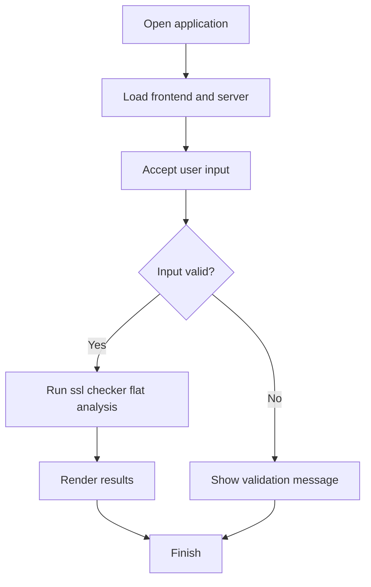

# 🔐 SSL Certificate Checker


## Get this repository

Clone the current project (this repository's canonical GitHub URL), then follow the installation and usage steps below.

```bash
git clone https://github.com/cyberworlduniversity/ssl-checker-flat.git
cd ssl-checker-flat
```

A web tool to instantly inspect SSL/TLS certificates for any website.

## Files in this folder

| File | Description |
|------|-------------|
| `server.js` | Express + Node.js backend (SSL checker API) |
| `package.json` | Node.js dependencies |
| `public/index.html` | Frontend (HTML + CSS + JS all-in-one) |
| `README.md` | This file |

## How to Run

```bash
npm install
npm start
```

Then open: **http://localhost:3001**

## Features

- Certificate Issuer (Organization, CN, Country)
- Validity Period (issued, expiry, days left)
- Encryption (TLS version, cipher suite)
- Security Score (0–100)
- Expiry warnings
- Subject Alt Names

## API

```
GET /api/check?url=example.com
```

---
Author: hemanathan115 · SSL Inspector v1.0


## Repository Quick Start

Clone the canonical repository:

```bash
git clone https://github.com/cyberworlduniversity/ssl-checker-flat.git
cd ssl-checker-flat
```

### Requirements and installation

- Node.js 18+

```bash
npm install
```

### Start the application

```bash
npm start
```

Open http://localhost:3001 in a browser.

### Build / validation

Check that dependencies install cleanly and that the application starts without runtime errors. No automated test script is currently declared in package.json.

Only submit domains you are authorized to assess. Certificate checks are informational and do not replace a full TLS audit.

### Application flow


